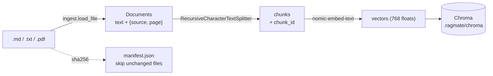
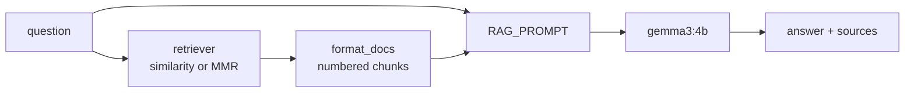
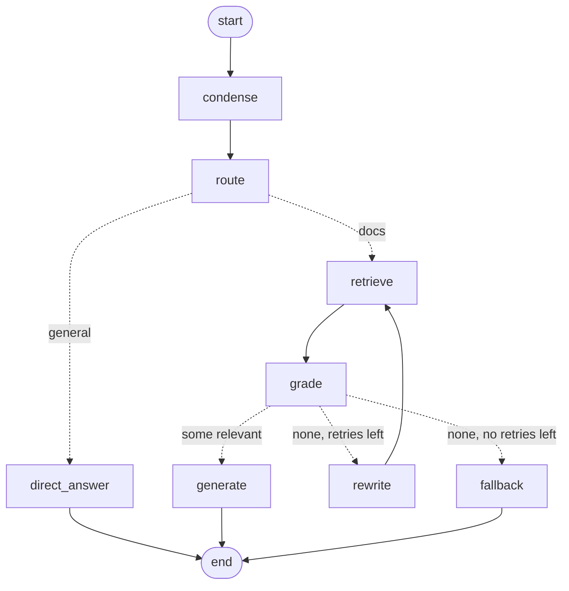

# How ragmate works

## 1. Indexing

- **Chunk ids are stable** (`file:p<page>:c<index>`), so re-adding a chunk overwrites it.
- A file whose hash changed has all its old chunks deleted before the new ones are added.
- The collection uses **cosine** distance; `ragmate inspect` shows the relevance scores (1 = same meaning).

## 2. Answering: plain RAG (`--mode rag`)

One retrieval, one model call. Fast, and good when questions are clear.

## 3. Answering: agentic RAG (`--mode agent`)

| Node | Model call | What it does |
|---|---|---|
| `condense` | chat (only with history) | turns a follow-up into a standalone question |
| `route` | structured `Route` | docs or small talk; any error → docs |
| `retrieve` | embedding | top-k chunks for the current query |
| `grade` | structured `Grade` per chunk | drops irrelevant chunks; any error → keep |
| `rewrite` | structured `Rewrite` | a better search query; bounded by `RAGMATE_MAX_RETRIES` |
| `generate` | chat | grounded answer from the kept chunks, with citations |
| `direct_answer` | chat | small talk, no retrieval |
| `fallback` | none | "not found in your documents" instead of guessing |

Cost: the agent makes roughly `2 + k` model calls per question (route, k grades, answer), plus more
on a rewrite. That is the price of the checks; `--mode rag` makes one.

## 4. Memory

The graph is compiled with an `InMemorySaver` checkpointer. Each run is saved under its
`thread_id`; `history` uses an `operator.add` reducer, so every turn appends `(human, ai)`. The CLI's
`chat` and each UI session have their own thread id; "New chat" in the UI starts a new one. For
memory that survives restarts, swap in `SqliteSaver` from `langgraph-checkpoint-sqlite`.
